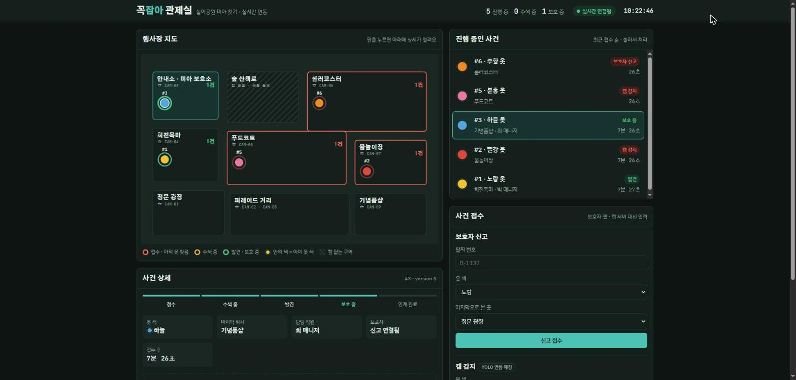
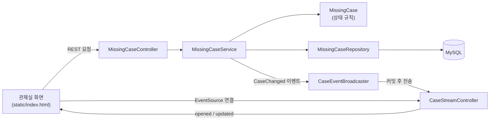
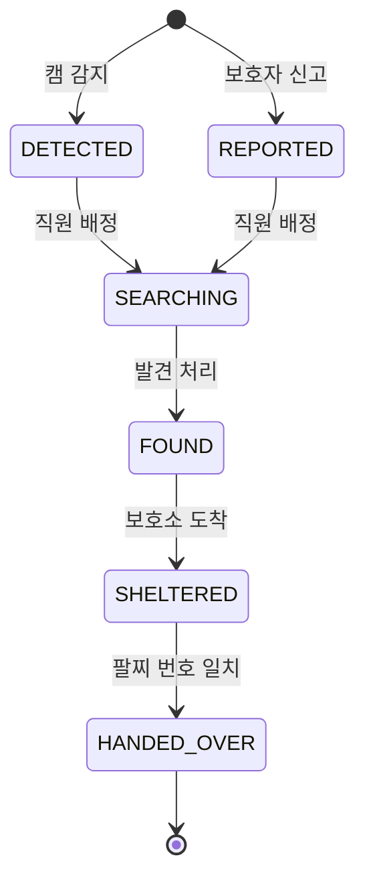

# 꼭잡아 — 놀이공원·행사장 미아 찾기 관제 시스템

놀이공원이나 큰 행사장에서 보호자와 떨어진 아이를 **빨리 찾고**, 보호자가 올 때까지 **안전하게 보호하다가**, **본인 확인을 거쳐 인계**하는 과정을 관리하는 관제 시스템입니다.

드론·CCTV로 인구 밀집도를 관제하던 팀 프로젝트에서 "카메라로 현장을 보고 직원에게 실시간으로 알린다"는 아이디어를 가져와, 미아 찾기라는 새 문제에 맞춰 혼자 다시 설계하고 구현했습니다.



> 탭 두 개로 관제실을 열고 한쪽에서 "발견 처리"를 누르면, 다른 탭의 지도 핀·목록·현황·알림이 1초 안에 함께 바뀝니다.

## 주요 기능

- **행사장 지도**: 진행 중인 사건이 구역별 핀으로 표시됩니다. 핀 안쪽 색은 아이 옷 색, 테두리는 진행 단계(빨강 접수 · 주황 수색 · 초록 발견/보호)입니다. 발견 위치가 바뀌거나 보호소로 옮기면 핀이 실시간으로 이동합니다.
- **두 갈래 접수**: 보호자 신고(팔찌 번호 + 옷 색 + 마지막 위치), 캠 감지(혼자 있는 아이를 카메라가 발견)
- **단계 관리**: 접수 → 수색 중 → 발견 → 보호 중 → 인계 완료. 단계를 건너뛸 수 없습니다.
- **본인 확인 인계**: 보호자가 보여 준 팔찌 번호가 신고 때 등록한 번호와 같을 때만 인계됩니다.
- **실시간 공유**: 사건이 생기거나 바뀌면 열려 있는 모든 관제 화면에 즉시 반영됩니다(SSE).
- **동시 수정 방지**: 다른 직원이 먼저 바꾼 사건을 오래된 화면에서 다시 바꾸려 하면 거절합니다.

## 기술 스택

| 영역 | 사용 |
|---|---|
| 백엔드 | Java 17, Spring Boot 4.1, Spring MVC, Spring Data JPA (Hibernate 7), Bean Validation |
| DB | MySQL 8.0, Flyway (스키마 버전 관리) |
| 실시간 | Server-Sent Events (`SseEmitter`) |
| 화면 | HTML · CSS · 순수 JavaScript (빌드 도구 없음, Spring Boot가 정적 파일로 제공) |
| 테스트 | JUnit 5, AssertJ, MockMvc, 실제 MySQL 테스트 DB |

## 구조



| 패키지 | 역할 |
|---|---|
| `missingcase.domain` | 사건 엔티티와 상태 규칙. **규칙은 여기에만 있습니다.** |
| `missingcase.service` | 트랜잭션 경계, 사건 조회, 버전 확인, 이벤트 발행 |
| `missingcase.web` | REST API, 요청/응답 모양, SSE 연결 관리 |
| `missingcase.event` | "사건이 생겼다/바뀌었다" 이벤트 |
| `common.web` | 예외 → HTTP 응답 변환(Problem Details) |

### 사건 상태



캠 감지로 시작한 사건은 보호자 정보가 없으므로, 보호자가 안내소에 오면 팔찌 번호를 **연결**한 뒤에만 인계할 수 있습니다.

## API

| 메서드 · 주소 | 설명 | 성공 |
|---|---|---|
| `GET /api/cases` | 진행 중인 사건 목록(최근 순) | 200 |
| `GET /api/cases/{id}` | 사건 하나 | 200 |
| `POST /api/cases/reports` | 보호자 신고로 사건 열기 | 201 + `Location` |
| `POST /api/cases/detections` | 캠 감지로 사건 열기 | 201 + `Location` |
| `POST /api/cases/{id}/guardian` | 캠 감지 건에 보호자 연결 | 200 |
| `POST /api/cases/{id}/assign` | 직원 배정 → 수색 중 | 200 |
| `POST /api/cases/{id}/found` | 발견 처리 | 200 |
| `POST /api/cases/{id}/shelter` | 보호소 도착 | 200 |
| `POST /api/cases/{id}/handover` | 팔찌 번호 확인 후 인계 | 200 |
| `GET /api/cases/stream` | 실시간 알림(SSE): `connected`, `opened`, `updated` | 200 |

- 단계 변경 요청은 `If-Match: "<version>"` 헤더를 선택적으로 받습니다. 화면이 마지막으로 본 버전과 DB 버전이 다르면 409를 돌려줍니다.
- 오류는 모두 [RFC 9457 Problem Details](https://www.rfc-editor.org/rfc/rfc9457) 형식입니다.

| 상태 | 언제 | 예시 `detail` |
|---|---|---|
| 400 | 요청 형식이 틀림 | `옷 색을 입력하세요.` |
| 404 | 없는 사건 | `999번 사건을 찾을 수 없습니다.` |
| 409 | 지금 단계에서 할 수 없는 일 | `캠 감지에서 보호 중(으)로 바로 넘어갈 수 없습니다.` |
| 409 | 다른 직원이 먼저 수정 | `다른 직원이 먼저 이 사건을 수정했습니다. 새로 고친 뒤 다시 시도하세요.` |

## 설계 결정

**1. 상태 규칙을 엔티티 안에 둔다.**
상태를 바꾸는 방법은 `assignStaff()`, `markFound()` 같은 엔티티 메서드뿐이고, 각 상태는 `CaseStatus.nextSteps()`로 다음에 갈 수 있는 단계를 스스로 압니다. 컨트롤러·서비스·화면 어디에서 호출해도 같은 규칙이 지켜지고, 규칙은 DB 없이 단위 테스트로 검증합니다.

**2. `PATCH {"status": ...}` 대신 행동별 주소를 둔다.**
"발견"에는 발견 위치가, "인계"에는 팔찌 번호가 반드시 필요합니다. 상태값만 받는 범용 주소로는 이 요구를 표현할 수 없어서 행동마다 주소와 요청 모양을 나눴습니다.

**3. 팔찌 번호는 응답에 넣지 않는다.**
팔찌 번호는 보호자가 본인임을 증명하는 값입니다. 관제 화면에 보이면 화면을 본 누구나 인계받을 수 있게 되므로, 응답에는 `guardianLinked`(연결 여부)만 담습니다. 테스트로도 확인합니다.

**4. 알림은 커밋된 뒤에만 보낸다.**
`@TransactionalEventListener`로 DB 커밋이 성공한 다음에만 SSE를 보냅니다. 커밋 전에 보내면 저장이 실패해 롤백됐는데도 화면에 "발견"이 뜰 수 있습니다. 서비스는 이벤트를 던지기만 하므로, 보호자 문자 알림 같은 수신자를 추가해도 서비스 코드는 바뀌지 않습니다.

**5. WebSocket 대신 SSE.**
화면이 서버에 보내는 동작은 이미 REST로 처리하므로, 실시간 통로는 서버 → 화면 한 방향이면 충분합니다. SSE는 HTTP 위에서 동작하고 끊기면 브라우저가 자동으로 다시 연결합니다. 다시 연결될 때마다 화면이 목록을 새로 받아 그사이 놓친 변경을 메웁니다.

**6. 시간차가 있는 동시 수정도 막는다.**
JPA `@Version`만으로는 정확히 동시에 들어온 요청만 잡힙니다. 직원 A가 1분 전 화면을 보고 버튼을 누르는 경우까지 막기 위해, 화면이 받은 `version`을 HTTP 표준 헤더 `If-Match`로 돌려보내고 서버가 비교합니다.

**7. 스키마는 Flyway로, Hibernate는 검사만.**
`ddl-auto=update`는 무엇이 언제 바뀌었는지 기록이 남지 않고, 이미 있는 컬럼의 타입은 바꾸지 않습니다. 테이블은 `V1__create_missing_case.sql`로 만들고 Hibernate는 `validate`로 엔티티와 테이블이 맞는지만 확인합니다. 상태 컬럼은 단계 추가 때마다 `ALTER`가 필요한 MySQL `ENUM` 대신 `VARCHAR`로 두었습니다.

**8. 화면은 규칙을 판단하지 않는다.**
다음에 누를 수 있는 버튼은 서버가 준 `nextSteps`로 정합니다. 사용자가 입력한 값은 이스케이프한 뒤 그려 XSS를 막습니다.

**9. 지도에는 진짜 데이터만 그린다.**
아이의 실시간 좌표나 이동 경로는 서버에 없으므로 지어내지 않고, 사건의 구역 정보만 핀으로 보여 줍니다. 보호 중인 아이는 기록된 발견 위치가 아니라 보호소에 표시합니다. 캠이 없는 구역(숲 산책로)은 캠 감지 접수에서 고를 수 없습니다. 핀은 지웠다 새로 그리지 않고 재사용하며 위치만 바꿔서, 이동이 애니메이션으로 보입니다. 키보드(Tab · Enter)와 화면 낭독기로도 핀을 고를 수 있습니다.

## 문제 해결 기록

**SSE 연결 때문에 서버 종료가 30초씩 멈춤**
- 증상: 테스트가 모두 통과한 뒤에도 JVM이 30초간 종료되지 않았습니다.
- 원인: Spring Boot는 처리 중인 요청이 끝나기를 최대 30초 기다렸다가 종료합니다(graceful shutdown). SSE 연결은 끝나지 않는 요청이라 매번 제한 시간을 다 채웠습니다.
- 처음 시도: `@PreDestroy`에서 연결을 닫았지만 효과가 없었습니다. 이 메서드는 그 기다림이 끝난 **뒤에** 호출되기 때문입니다.
- 해결: 종료 신호(`ContextClosedEvent`)를 받자마자 열린 연결을 모두 닫도록 바꿨습니다. 전체 테스트 시간이 47초에서 17초로 줄었고, 운영에서 재시작할 때 멈추는 문제도 함께 막았습니다.

**Flyway 전환 후 Hibernate 검증 실패 대비**
- Hibernate 7은 MySQL에서 enum 필드를 `ENUM` 컬럼으로 기대합니다. 마이그레이션에서 `VARCHAR`로 만들었기 때문에 `validate`가 앱 시작을 막을 수 있어, 필드에 `@JdbcTypeCode(SqlTypes.VARCHAR)`를 붙여 의도를 명시했습니다.

**테스트 트랜잭션 때문에 버전이 오르지 않음**
- MockMvc 테스트는 테스트 하나를 트랜잭션 하나로 묶고 끝나면 롤백합니다. 그래서 요청 사이에 커밋이 없어 `version`이 오르지 않았고, 동시 수정 테스트가 의미가 없었습니다. 해당 테스트만 `Propagation.NOT_SUPPORTED`로 실제 커밋이 일어나게 했습니다.

## 테스트

`./mvnw test` 한 번으로 19개를 실행합니다. 실제 MySQL(`kkokjaba_test`)을 쓰고, 테이블은 운영과 같은 Flyway 마이그레이션으로 만듭니다.

| 테스트 | 범위 | 확인하는 것 |
|---|---|---|
| `MissingCaseTest` | 도메인(DB 없음) | 전체 흐름, 단계 건너뛰기 거절, 팔찌 불일치, 빈 값 |
| `MissingCaseRepositoryTest` | JPA + MySQL | 저장·조회, 변경 감지, 진행 중 목록 쿼리 |
| `MissingCaseApiTest` | HTTP → DB 전체 | 201/400/404/409, 팔찌 번호 비노출, 시간차 동시 수정 |
| `CaseStreamTest` | 실제 포트 + SSE | 생성·변경 알림 도착, 실패한 요청은 알림 없음 |
| `KkokjabaApplicationTests` | 앱 전체 | 설정과 빈이 모두 뜨는지 |

## 실행 방법

필요한 것: JDK 17 이상, MySQL 8.0

```bash
# 1. DB와 앱 전용 계정 만들기
#    db/setup-local.example.sql 을 db/setup-local.sql 로 복사 → CHANGE_ME 를 비밀번호로 바꾸기
#    → MySQL root 계정으로 실행

# 2. 앱이 쓸 비밀번호 넣기
#    config/local.properties.example 을 config/local.properties 로 복사 → 같은 비밀번호 입력
#    (또는 환경변수 DB_PASSWORD 사용)

# 3. 테스트와 실행
./mvnw test
./mvnw spring-boot:run      # Windows: .\mvnw.cmd spring-boot:run
```

브라우저에서 <http://localhost:8081/> 을 엽니다. 테이블은 처음 실행할 때 Flyway가 만듭니다.

## 한계와 다음 계획

지금은 로컬 시연용입니다. 실제 운영 전에 아래가 필요합니다.

- **인증·권한이 없습니다.** 누구나 API를 호출할 수 있습니다. 직원 로그인(Spring Security)과 역할별 권한(관제실 / 현장 직원 / 안내소)이 가장 먼저 필요합니다.
- **SSE 연결 목록을 서버 메모리에 둡니다.** 서버가 한 대일 때만 맞게 동작합니다. 여러 대로 늘리면 Redis Pub/Sub 등으로 서버끼리 이벤트를 나눠야 합니다.
- **알림 전송이 요청 스레드에서 동기로 실행됩니다.** 연결된 화면이 많아지면 응답이 느려질 수 있어 비동기 전송이 필요합니다.
- **캠 감지는 화면에서 수동으로 넣습니다.** 다음 단계로 Python(YOLO) 감지 서버가 `POST /api/cases/detections`를 호출하도록 연결할 계획입니다. 이 시스템은 얼굴 인식 없이 옷 색·위치만 사용하도록 설계했습니다.
- **구역 목록과 캠 배치가 화면 코드에만 있습니다.** 서버는 구역 이름을 검사하지 않아 API로 지도에 없는 구역을 넣을 수 있습니다(화면은 "지도 밖 위치"로 따로 알려 줍니다). 구역·캠을 DB 테이블로 옮겨 서버가 검증하고, 캠 감지는 캠이 있는 구역에서만 받도록 해야 합니다.
- **개인정보 보관 기간 정책이 없습니다.** 인계가 끝난 사건 기록을 얼마나 보관하고 언제 지울지 정해야 합니다.
- 화면의 경과 시간 표시는 서버와 브라우저가 같은 시간대(Asia/Seoul)라고 가정합니다.

## 디렉터리

```
src/main/java/com/jjh/kkokjaba
├── common/web/            ApiExceptionHandler, StatusController
└── missingcase/
    ├── domain/            MissingCase, CaseStatus, CaseRuleException
    ├── event/             CaseChanged
    ├── repository/        MissingCaseRepository
    ├── service/           MissingCaseService, CaseNotFoundException
    └── web/               MissingCaseController, CaseStreamController,
                           CaseEventBroadcaster, CaseRequests, CaseResponse
src/main/resources
├── db/migration/          V1__create_missing_case.sql
└── static/                index.html, css/app.css, js/app.js
```
